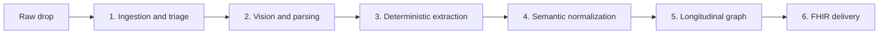

# EHR Migration Engine

An electronic health record migration is a high-stakes extract, transform, and load job. Clinics hand over scanned PDFs, faxed lab tables, and legacy database dumps. A modern EHR can only compute against a strict, standardized model. This engine forces that clinical chaos into one.

The pipeline runs locally: Surya for layout-aware OCR, a local Qwen model served by vLLM for schema-bound extraction, and Neo4j for longitudinal GraphRAG. Nothing in the path is a free-form summary. Each stage emits a typed artifact the next stage can reject.



## Phase 1: Ingestion and triage

Legacy clinics do not hand over clean databases. They hand over zip files of mixed formats over secure SFTP.

- **Format triage.** `ingestion/router.py` classifies each file as structured (HL7 v2, CSV), semi-structured (CCDA XML), or unstructured (scanned PDFs, faxes, JPEGs).
- **Decoupling.** `ingestion/pdf_handler.py` splits multi-page PDFs and tags each page with source metadata: date received, source clinic, and original filename.

Landed files sit in `data/01_raw`. Classified, split pages land in `data/02_triage`.

## Phase 2: Vision and parsing

Standard OCR fails on medical documents. It scrambles lab rows and misreads dosages. Surya is used because the page has to be read as a layout, not as a stream of tokens.

- **Layout analysis.** `vision/surya_client.py` returns bounding boxes that separate a clinician's free-text note, a blood-work table, and the demographic header.
- **Cell-level extraction.** `vision/spatial_parser.py` keeps row and column alignment so a "Glucose" cell stays bound to "105 mg/dL" and "High".

OCR output is written to `data/03_ocr`.

## Phase 3: Deterministic extraction

The local Qwen/vLLM stack is a parser, not a summarizer. A deterministic finite automaton in `extraction/state_machine.py` only accepts output that matches the JSON schemas in `extraction/schemas.py`.

- **Entity recognition.** `extraction/engine.py` asks the model for five clinical entities: demographics, encounters, conditions, medications, and observations (labs and vitals).
- **Schema enforcement.** If the model emits a field the schema does not define, the state machine rejects the payload and loops the extraction. Hallucinated keys never leave this stage.

Accepted records are written to `data/04_structured`.

## Phase 4: Semantic normalization

The string "heart attack" or "Tylenol" is useless to a target EHR. `normalization/mappers.py` maps surface forms onto the ontologies the receiving system already computes against.

| Domain | Ontology | Example |
| --- | --- | --- |
| Diagnoses and conditions | ICD-10 or SNOMED CT | "Heart attack" → SNOMED `22298006` |
| Medications | RxNorm | "Tylenol 500mg" → RxNorm `198440` |
| Labs and vitals | LOINC | A glucose row → the LOINC code for that observation |

This mapping is the hardest stage. Two source systems can describe the same fact with different words, abbreviations, and units, and the target system will treat them as different facts unless the codes match.

## Phase 5: Longitudinal mapping

Flat-file migrations store isolated rows. This stage stitches those rows into a chronology in Neo4j, which is what later GraphRAG queries read.

- **Timeline reconstruction.** `graph/timeline.py` links an encounter (an ER visit on a given day) to the condition diagnosed that day, the provider seen, and the medication prescribed.
- **Deduplication.** `graph/neo4j_client.py` merges nodes when birth date and other stable identifiers agree. "Rob Smith" on a legacy dump and "Robert Smith" on a fax become one patient, so the target EHR does not receive two charts.

## Phase 6: Standardization and target injection

`fhir/serializer.py` serializes the graph into FHIR R4 JSON: `Patient`, `Encounter`, `Condition`, `MedicationStatement`, and `Observation`. Those resources are what Epic, Cerner, and VyeOS ingest.

The delivery step authenticates to the target EHR and POSTs each payload. Rejected resources are captured with the operation outcome so a record can be corrected and retried without replaying the whole chart. Serialized bundles are written to `data/05_fhir`.

## Repository layout

```
src/ehr_migration_engine/
├── ingestion/        # router, PDF split, source metadata
├── vision/           # Surya client, spatial table parser
├── extraction/       # Qwen/vLLM engine, JSON schemas, DFA
├── normalization/    # SNOMED CT, ICD-10, RxNorm, LOINC mappers
├── graph/            # Neo4j client, encounter timeline
└── fhir/             # FHIR resource serializer
data/
├── 01_raw/
├── 02_triage/
├── 03_ocr/
├── 04_structured/
└── 05_fhir/
scripts/data_gen/     # Synthea runs and synthetic dirty-fax pages
tests/                # ingestion, spatial parsing, state machine, FHIR
```

`data/` is gitignored. It holds source documents and derived artifacts, including protected health information when the pipeline is pointed at a real clinic drop.

## Development

Requires Python 3.11. Dependencies are managed with [uv](https://docs.astral.sh/uv/).

```bash
uv sync
uv run ehr-migration-engine
```

Synthetic source documents are produced from `scripts/data_gen/` (Synthea for structured charts, dirty-fax generation for unstructured pages) so the pipeline can be exercised without real patient data.
